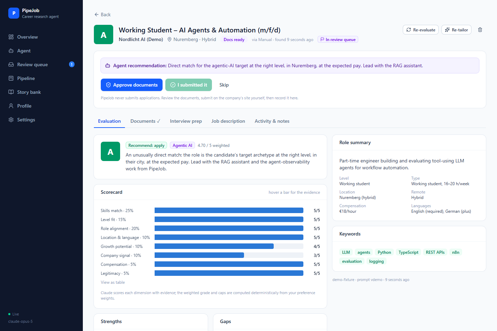
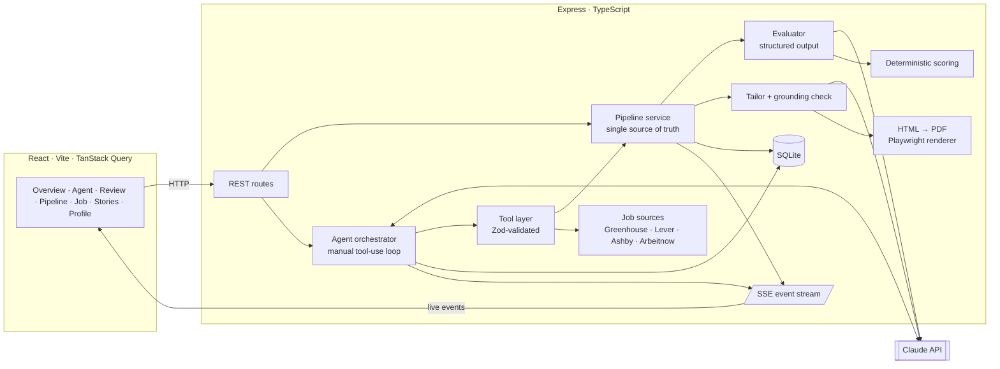
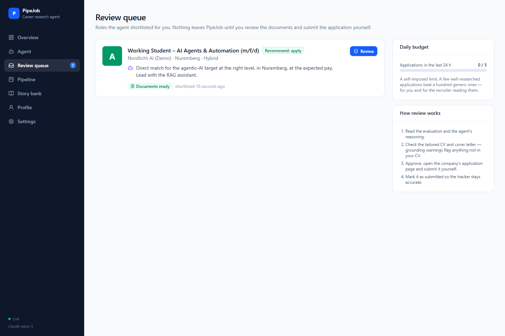
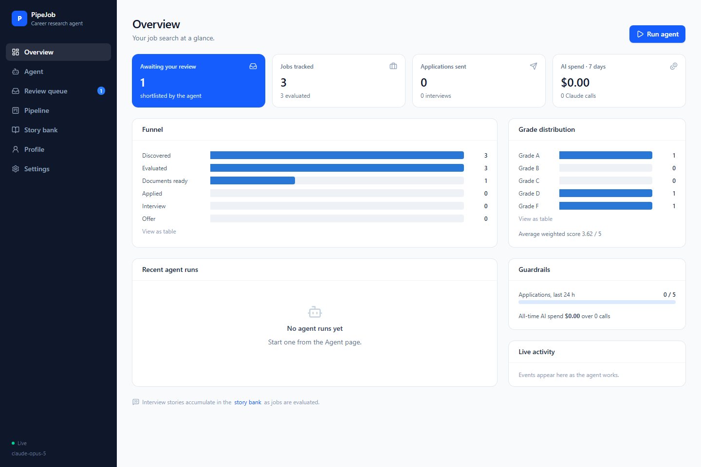

# PipeJob — an agentic career research assistant

PipeJob is a tool-using **Claude agent** that does the research part of a job search: it scans companies' official job boards, scores each role against your CV and preferences with evidence, writes a tailored CV and cover letter for the strongest matches, and hands you a short, reasoned shortlist.

**It never applies on your behalf.** Every application is reviewed, approved and submitted by the human. The goal is fewer, better applications, which is better for the candidate and for the recruiter reading them.



<sub>Screenshots use the fictional demo fixtures from `npm run seed:demo`.</sub>

---

## What it does

| | |
|---|---|
| **Agent runs** | Give a goal in plain language ("find working-student roles in agentic AI in Germany and shortlist the best three"). The agent plans, calls tools, evaluates, tailors and reports. Every reasoning summary, tool call, token and cent is streamed live and stored. |
| **Evidence-based evaluation** | Eight scored dimensions (skills, level fit, role alignment, location, growth, company, compensation, legitimacy), each with a cited justification. The **grade (A–F) is computed in code** from your weights, with hard caps for deal-breakers, suspicious postings and seniority mismatches. |
| **Grounded tailoring** | The tailored CV and cover letter may only rephrase facts from your master CV. A code-level check removes invented skills, employers and projects, and flags metrics that don't appear in the CV. |
| **Human-in-the-loop review** | Shortlisted jobs land in a review queue. You approve the documents, submit on the company's site yourself, then record it. A daily application budget keeps things deliberate. |
| **Official sources only** | Jobs come from companies' public Greenhouse, Lever and Ashby job-board APIs and the free Arbeitnow API, which exist so openings can be discovered. No scraping, no bot-detection evasion, and an honest `User-Agent`. |
| **Interview prep** | Likely questions, talking points, questions to ask, and STAR + Reflection stories. Stories are merged into a reusable **story bank** across evaluations. |
| **Tracking** | Kanban pipeline, status history recording who acted (you, the agent or the system), notes, and an overview with funnel, grade distribution and AI spend. |
| **Automation hooks** | Optional scheduled "autopilot" runs, Telegram notifications, and n8n webhooks. None of them can submit an application. |

---

## Architecture



The REST routes, the agent's tools and the n8n webhooks all call the same **pipeline service**, so a job evaluated by the agent and one evaluated by clicking a button go through identical code, validation and state transitions.

### The agent loop

`server/src/agent/orchestrator.ts` runs a manual Messages API loop instead of the SDK's tool runner. That's a deliberate trade: owning the loop makes every step observable and lets the guardrails live in one place.

1. Send the conversation with `thinking: adaptive` (summaries shown in the UI), the tool definitions and prompt caching.
2. Persist and stream each thinking summary, text block and `tool_use` block.
3. Validate each tool input against its Zod schema, run the tools (bounded concurrency, parallel calls allowed), and return **all results in a single user message**.
4. Stop on `end_turn`. Handle `pause_turn` and `refusal` explicitly. On the last allowed turn, set `tool_choice: none` so the model must write its report.

| Tool | Purpose | Guardrail |
|---|---|---|
| `get_candidate_profile` | CV highlights, preferences, pipeline snapshot | read-only |
| `search_jobs` | Query official job-board APIs, save new matches | cached 30 min, capped results |
| `list_pipeline` / `get_job_details` | Read tracked jobs | read-only |
| `import_job` | Add a job from a URL or pasted text | ATS URL → official API; otherwise schema.org `JobPosting`, then LLM extraction |
| `evaluate_job` | Structured 8-dimension evaluation | per-run budget; cached unless `force` |
| `tailor_application` | Tailored CV and cover letter PDFs | only at or above your minimum grade; per-run budget; grounding check |
| `shortlist_for_review` | Hand-off to the human | requires an evaluation |
| `skip_job` | Dismiss clear mismatches with a reason | can't touch applied/interview/offer |

There is intentionally **no tool that applies, submits or contacts anyone**, and a unit test asserts it.

### Why the grade is computed in code

LLMs are good at reading a job description and citing evidence, but they are unreliable calculators and drift between runs. The model returns per-dimension scores with justifications (`services/evaluation/schema.ts`). `services/evaluation/scoring.ts` then clamps them, applies your weights and hard caps, and produces the grade. The result is reproducible, tunable from the Profile page without re-prompting, and covered by unit tests.

### Reliability and cost

- **Structured outputs** (`client.beta.messages.parse` with a Zod schema) replace brittle `JSON.parse` on free text.
- **Prompt caching**: stable content (rubric, CV, preferences, tool definitions) comes first, so batch evaluations and multi-turn runs are served largely from cache. The UI shows the cached share.
- **Refusal fallbacks** are enabled server-side for supported models, and `refusal` / `max_tokens` stop reasons are handled explicitly.
- **Telemetry**: every Claude call is logged with purpose, tokens, cache hits, latency and estimated cost (the `llm_calls` table), surfaced on the Overview page.
- **Budgets**: turns, evaluations and tailored applications per run, one active run at a time, and a daily application budget.

---

## Screenshots

| Review queue — the human-in-the-loop hand-off | Overview — funnel, grades, guardrails, AI spend |
|---|---|
|  |  |

---

## Quick start

Prerequisites: Node.js 20+.

```bash
npm run setup                      # installs all packages + the Chromium used for PDF rendering
cp server/.env.example server/.env # then set ANTHROPIC_API_KEY
npm run dev                        # API on :3001, dashboard on http://localhost:5173
```

Then:

1. **Profile → Master CV**: replace the sample CV (a fictional student) with your own. **Profile → Search preferences**: set target roles, locations, deal-breakers and weights.
2. **Pipeline → Scan portals** for a quick keyword scan (no AI cost), or go to **Agent** and run a goal.
3. Work through the **Review queue**.

No API key yet? The tracker and portal scan still work. `npm run seed:demo` adds three clearly labelled fictional jobs with pre-computed evaluations and rendered documents, so you can explore the UI offline.

### Configuration

| File | What it holds |
|---|---|
| `server/.env` | API key, model, effort levels, agent budgets, autopilot cron, webhook secret. See `server/.env.example`. |
| `master-cv.json` | Your master CV: the only source of facts for tailoring. |
| `preferences.json` | Target roles/archetypes, locations, must-haves, deal-breakers, scoring weights, minimum grade. |
| `portals.json` | Companies to scan: `{ name, ats: greenhouse \| lever \| ashby, slug }`. The slug is the board name in the careers URL. |

### Tests

```bash
npm test
```

The tests cover scoring and grade caps, the grounding guardrail, HTML and schema.org parsing, search ranking, ATS URL detection, the repository layer, tool validation and budgets, and the agent loop against a scripted model (parallel tool results, error recovery, forced wrap-up, refusals).

---

## Project structure

```
server/src
  agent/            orchestrator (loop), tools (Zod schemas → JSON Schema), system prompt
  services/
    evaluation/     schemas, evaluator prompt, deterministic scoring
    tailoring/      tailor prompt, grounding check, CV/cover-letter templates, PDF renderer
    sources/        Greenhouse/Lever/Ashby/Arbeitnow clients, search + ranking, URL importer
    pipeline.ts     state transitions shared by API, agent and webhooks
  llm/client.ts     Anthropic client, structured calls, cost tracking, refusal fallbacks
  db/               SQLite schema + additive migrations, repositories
  routes/           REST, SSE, n8n webhooks
client/src
  pages/            Overview, Agent (live trace), Review, Pipeline, JobDetail, Stories, Profile, Settings
  lib/events.tsx    one SSE connection that keeps React Query caches live
cvtemplate/         the Overleaf template the PDF design is based on
```

## Design decisions & trade-offs

- **Manual loop over the SDK tool runner**: more code, but full control over tracing, budgets, cancellation and the forced final turn.
- **One agent with coarse tools, not a multi-agent swarm**: evaluation and tailoring are focused sub-calls with their own schemas and prompts. That gives the benefits of specialisation without the coordination overhead.
- **Keyword prefilter, then LLM judgement**: portal search is cheap, deterministic ranking. The agent decides what is worth an evaluation, so tokens go to judgement, not string matching.
- **SQLite and SSE**: zero infrastructure for a single-user tool; a dependency like Redis would only add setup friction.
- **No auto-apply**: automatic submission is where job tools become spam. Keeping the human in control is a product decision, not a missing feature.

## Roadmap

- An evaluation set of labelled postings to measure grading quality across prompt versions.
- Company research tool (web search) for the "company signal" dimension.
- Inbox integration to move applications to interview/rejected automatically.

## Acknowledgements

- Evaluation dimensions, the story bank and the "never auto-submit" stance were inspired by [career-ops](https://github.com/BobbyWang0120/career-ops).
- The CV design follows the [Data Science / Tech Resume](https://www.overleaf.com/latex/templates/data-science-tech-resume-template/zcdmpfxrzjhv) Overleaf template by Timmy Chan (see `cvtemplate/`).
